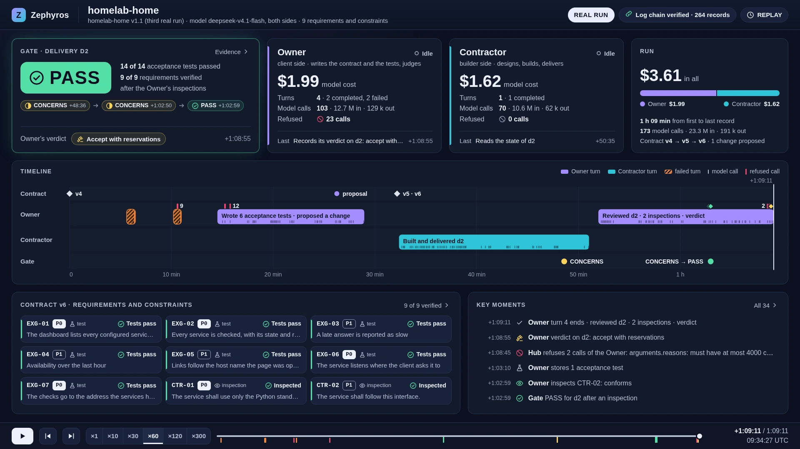

# Dashboard mockup

A living mockup of the dashboard of [ADR 0021](../../decisions/0021-read-only-dashboard-on-its-own-listener.md),
on the data of the third real run (homelab-home v1.1: an Owner and a Contractor on a real model,
one delivery, CONCERNS then PASS after two inspections, a verdict with reservations). It is static
HTML, CSS and JavaScript with no build step, and it shows what the dashboard is meant to show and
how. The [implementation plan](implementation-plan.md) turns it into five tickets.



## Open it

Serve this folder over HTTP on the loopback interface, from the root of the repository:

```sh
python3 -m http.server --bind 127.0.0.1 --directory docs/design/dashboard 8765
```

and open `http://127.0.0.1:8765/` (any free port will do). A page opened from a file cannot load
its data: browsers refuse module scripts and `fetch` on `file://`.

It opens at the end of the run, the decision first. Press play (or space) to replay the run;
arrows jump between key moments. Every card, bar and marker opens its detail: the gate's card
opens the delivery and its evidence, a side opens its last turn, a requirement opens its
coverage and its state at each decision, the refused calls open the refusals.

| Parameter | Effect |
| --- | --- |
| `at=end`, `at=start`, `at=<seconds>`, `at=e<event id>` | where the playhead starts (default `end`) |
| `play=1`, `speed=1\|10\|30\|60\|120\|300` | play from there, at that speed |
| `mode=live` | the live view: no transport, the clock runs at the speed of the run |
| `open=delivery:d2`, `open=turn:contractor:1`, `open=contract`, `open=refusals`, `open=moments`, `open=req:CTR-01` | open a detail |
| `data=<name>.replay.json` | another replay in `data/` |
| `hostile=1` | plant the strings of ATK-67 in the data (see below) |

For example: `?mode=live&at=2580` is the live view while the Contractor builds; `?at=2935` is the
first decision, CONCERNS; `?open=delivery:d2` is the evidence of the delivery.

The page answers to the interface of the replay recorder of pull request #6
(`window.replay.play`, `pause`, `seek`, `focus`, `setSpeed`, `caption`, `state`), plus `open`
and `close` for the details, so a video can be recorded from it.

## What is real and what is not

- **Real**: every event comes from the hub's log of the run (records 238 to 501, exported with
  their hash chain verified), the contract versions from the hub's tables, the agents' messages
  from their transcripts, the tokens from the gateway's records. Costs use the list price given to
  the exporter ($0.15 per million tokens in, $0.60 out), as the README of the repository does.
- **Approximated in the browser**: the state of each requirement at each decision. The replay
  holds each test's outcome, not the gate's table by requirement, so the mockup counts an object
  verified by test as verified when every acceptance test passed, and one verified by inspection
  when an inspection conforms. For this run it gives the hub's three decisions exactly. The
  dashboard takes the table from the gate (ADR 0021); the browser never computes it.
- **Shaped by the mockup**: the label of each turn ("Built and delivered d2") and the families of
  refusal reasons follow the rules in `js/model.js`; transcript messages exported twice are shown
  once.
- **Masked**: the client's repository is private, so its owner is renamed `example-user` in the
  data, and the page shows the pull request's number without a link. The log chain's hashes
  describe the records as exported, before this renaming. The data holds no personal name, no
  private address and no path of a machine; loopback addresses (`127.0.0.x`) are part of the
  client's own requirements.

## Design choices

- **Overview first, detail on demand.** One screen, sized for 1920 × 1080 and a 1080p video: the
  gate's decision and its trail, the Owner's verdict, the two sides and what they cost, a timeline,
  the requirements, the key moments. Everything else is one click away in a drawer that keeps the
  overview in sight. No text under 13 px; the headline numbers are 40 px and more.
- **Facts and speech look different.** What the hub recorded is plain text with icons; what an
  agent wrote is a quotation with the colour of its side. A decision or a verdict is drawn only
  from structured fields, never from text.
- **Refusals are classified.** Out of role, identity, malformed calls, network, limits. In this run
  all 23 refusals are the Owner's malformed calls (paths and a tool that do not exist, a verdict
  over 4 000 characters): no call outside a role, which the page says in words.
- **Colour.** A dark theme. Text tokens are at least 5.6:1 on every surface (primary 15.4:1,
  secondary 9.5:1, muted 6.2:1 on cards). Owner (violet `#a48cff`) and Contractor (cyan
  `#2fc4d8`) stay apart for every colour-vision deficiency (OKLab ΔE × 100: 19.6 normal, 14.5
  protan, 10.1 deutan, 13.2 tritan). The status colours (good `#54dfa7`, warning `#fad25a`,
  serious `#f2843a`, critical `#ef476f`) are at least 15 apart for normal vision and 9 apart under
  each simulated deficiency (Machado 2009), and never travel without an icon and a word. The
  operator and the hub are drawn by shape, not by hue.
- **Safe by construction.** The page has no inline script or style and runs under the policy the
  dashboard will send (`default-src 'none'; script-src 'self'; …`). Every string from the data
  becomes a text node (`js/dom.js`); attributes come from a closed list; a link is made only to an
  https address of the forge. With `?hostile=1`, script tags, `onerror` images, `javascript:`
  links, Markdown image beacons, CSS and a right-to-left override are planted in a requirement, a
  branch name, an agent's message, an inspection, a refusal and the pull request's address: they
  show as text, no element is created from them, and every request of the page stays on its
  origin.
- **Accessible.** Every action works with the keyboard; a drawer takes the focus and gives it back;
  a new decision is announced to screen readers; motion stops under `prefers-reduced-motion`.

## Files

| File | Content |
| --- | --- |
| `index.html`, `style.css`, `favicon.svg` | the page |
| `js/model.js` | the replay turned into the views, at any instant (`stateAt`) |
| `js/overview.js`, `js/timeline.js`, `js/drawers.js`, `js/player.js` | the screens and the transport |
| `js/dom.js`, `js/format.js` | safe DOM building, icons, formats |
| `js/hostile.js` | the strings of `?hostile=1` |
| `data/run3.replay.json` | the third real run, format `zephyros-replay` 1.0.0, masked as above |
| `screenshots/` | the overview at the end, the live view during the build, the evidence of the delivery |
